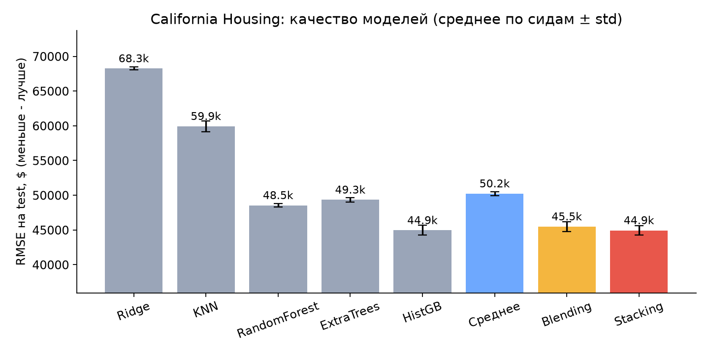
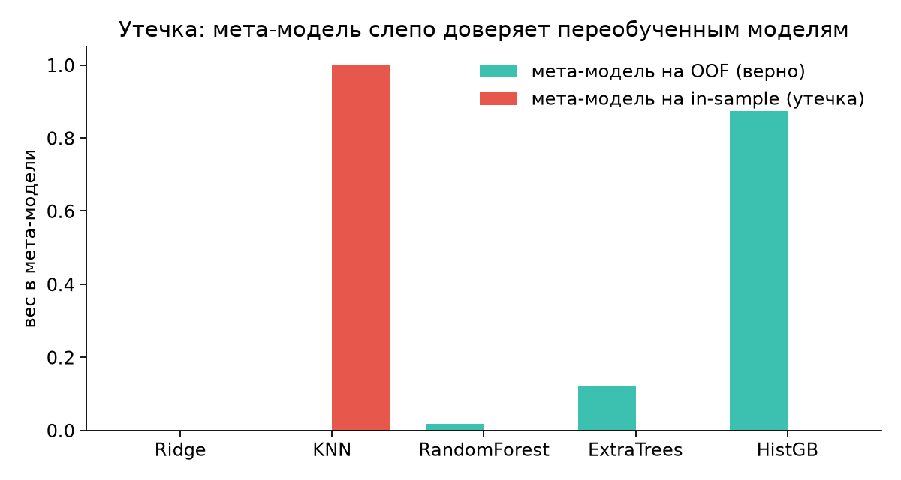
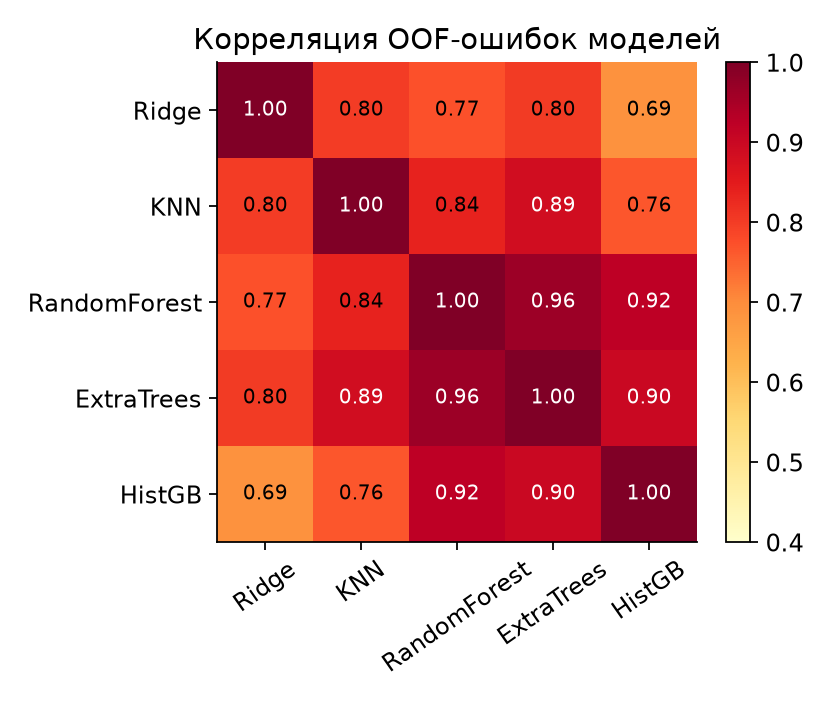
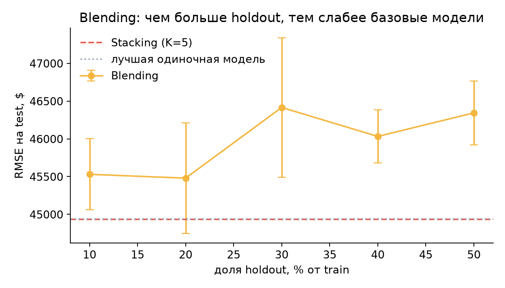

# 1. Введение

Одна модель редко оказывается лучшей на всех участках пространства признаков: линейная модель хорошо ловит глобальный тренд, метод ближайших соседей - локальную структуру, деревья - нелинейные взаимодействия. **Ансамблирование** объединяет несколько моделей так, чтобы их сильные стороны складывались, а ошибки частично гасили друг друга.

Три классических подхода отвечают на разные вопросы:

| Подход | Как строится ансамбль | Что уменьшает |
|---|---|---|
| Bagging (случайный лес) | независимые модели на бутстрэп-выборках, усреднение | дисперсию |
| Boosting (градиентный бустинг) | модели строятся последовательно, каждая исправляет ошибки предыдущих | смещение |
| **Stacking / Blending** | разные по природе модели, а их предсказания объединяет **обучаемая** мета-модель | выбор и взвешивание моделей |

Цель работы: разобрать идею stacked generalization, сравнить схемы Stacking (на out-of-fold предсказаниях) и Blending (на отложенной выборке), реализовать их с нуля и проверить на реальных данных, включая типичную ошибку - утечку данных в мета-признаках.

# 2. Теория

## 2.1. Идея Stacked Generalization

Метод предложил Д. Волперт в 1992 году (*Stacked generalization*, Neural Networks, 5(2), 241-259). Схема двухуровневая:

* **уровень 0**: $M$ базовых моделей $f_1, \dots, f_M$, обученных на исходных данных $(x, y)$;
* **уровень 1**: мета-модель $g$, для которой входом служат *предсказания* базовых моделей, а целью - прежний $y$:

$$\hat y(x) = g\big(f_1(x),\, f_2(x),\, \dots,\, f_M(x)\big).$$

Мета-модель учится отвечать на вопрос: «в каких ситуациях какой модели и насколько стоит доверять». Простейший вариант - $g$ линейна, $\hat y = b + \sum_m w_m f_m(x)$; тогда stacking есть обучаемое взвешенное среднее, а простое усреднение ($w_m = 1/M$) является его частным случаем.

## 2.2. Главная проблема: утечка данных

Наивная реализация: обучить $f_m$ на train, получить $f_m(x_i)$ для тех же $x_i$ и на этих числах учить $g$. Так делать нельзя. Модель, запомнившая обучающие данные (KNN с $k=1$, глубокое дерево, лес), на train почти безошибочна. Мета-модель видит «идеальные» предсказания, приходит к выводу, что этой модели нужно доверять полностью, а на новых данных ошибка оказывается большой. Формально распределение мета-признаков на train и на test различается: на train они оптимистичны.

Поэтому мета-признаки для объекта $x_i$ должны быть получены моделью, **которая этот объект не видела**.

## 2.3. Stacking: out-of-fold (OOF) предсказания

Выборка делится на $K$ фолдов; $k(i)$ - номер фолда объекта $i$. Для каждой модели $m$ и фолда $k$ модель $f_m^{(-k)}$ обучается на всех фолдах, кроме $k$-го. Тогда мета-признак объекта $i$:

$$z_{im} = f_m^{(-k(i))}(x_i).$$

Алгоритм обучения:

1. разбить train на $K$ фолдов (для классификации - стратифицированно);
2. для каждой модели $m$ и фолда $k$ обучить $f_m^{(-k)}$ и предсказать фолд $k$; склеить OOF-столбец $z_{\cdot m}$;
3. обучить мета-модель $g$ на $(Z, y)$, где $Z \in \mathbb{R}^{n \times M}$;
4. переобучить каждую $f_m$ на **всём** train - они понадобятся для предсказания.

Предсказание для нового $x$: посчитать $f_1(x), \dots, f_M(x)$ и подать в $g$. (Альтернатива шагу 4 - усреднить $K$ моделей, обученных в фолдах; это дешевле, но мета-признаки на test чуть отличаются по природе от OOF.)

Стоимость обучения: $M(K+1)$ обучений базовых моделей.

## 2.4. Blending: отложенная выборка

Blending - упрощённая схема, закрепившаяся в практике соревнований (в частности, Netflix Prize, 2006-2009). Вместо $K$ фолдов используется одно разбиение:

1. train делится на $\text{train}'$ (например, 80 %) и $\text{holdout}$ (20 %);
2. базовые модели обучаются на $\text{train}'$;
3. их предсказания на holdout образуют матрицу $Z$;
4. мета-модель обучается на $(Z, y_\text{holdout})$.

Базовые модели обычно **не** переобучаются на всём train, иначе мета-модель окажется настроенной на предсказания других моделей. Стоимость: $M$ обучений.

## 2.5. Сравнение

| | Stacking (OOF) | Blending (holdout) |
|---|---|---|
| Данные для базовых моделей | почти весь train в каждом фолде + полное переобучение | только $1-h$ от train |
| Данные для мета-модели | весь train ($n$ объектов) | только holdout ($hn$ объектов) |
| Стоимость | $M(K+1)$ обучений | $M$ обучений |
| Риск утечки | нет, если фолды заданы корректно | мал; но мета-признаки можно «переобучить» на малом holdout |
| Оценка качества | OOF-метрики доступны бесплатно | метрика на holdout, шумная |
| Простота | сложнее | проще |

## 2.6. Практические рекомендации из литературы

* **Мета-модель должна быть простой.** Бреймен (*Stacked regressions*, Machine Learning, 24, 1996) показал, что для регрессии хорошо работают линейные комбинации с неотрицательными весами; в нашем коде это `LinearRegression(positive=True)`.
* **Для классификации - вероятности, а не метки.** Тинг и Виттен (*Issues in stacking*, JAIR, 10, 1999) показали, что мета-признаками лучше брать вероятности классов; мета-моделью - логистическую или линейную регрессию.
* **Разнообразие моделей важнее их числа.** Добавление копии уже имеющейся модели (RandomForest рядом с ExtraTrees) почти ничего не даёт: важны сопоставимое качество и разные ошибки.
* **Обоснование.** В работе ван дер Лаана и соавторов (*Super Learner*, 2007) показано, что при выборе по кросс-валидации ансамбль асимптотически не хуже лучшей модели из набора.
* **Корректные фолды.** Для временных рядов - разбиение по времени; для зависимых объектов (один пользователь, одна группа) - `GroupKFold`; препроцессинг, который обучается на данных (импутация, масштаб), должен находиться внутри пайплайна модели.
* **Многоуровневый stacking** возможен, но стоимость растёт, а прирост быстро падает.

# 3. Реализация

Код находится в пакете `src/stacking_lib` (файл `ensembles.py`). Реализованы два класса с интерфейсом scikit-learn:

* `Stacking(base_models, meta_model, n_splits=5, task=...)` - OOF-схема из раздела 2.3, матрица `oof_` доступна после `fit`;
* `Blending(base_models, meta_model, holdout_size=0.2, task=...)` - схема из раздела 2.4.

Оба класса работают и для регрессии, и для классификации (в мета-признаки идут вероятности классов, один столбец отбрасывается из-за коллинеарности). Корректность проверена тестами `tests/test_ensembles.py`: в том числе предсказания `Stacking` совпадают с `sklearn.ensemble.StackingRegressor` при тех же моделях и фолдах (в эксперименте максимальная разница предсказаний равна 0.0), а OOF-предсказания 1-NN не повторяют обучающие ответы, в отличие от in-sample.

# 4. Эксперименты

## 4.1. Данные и модели

**Данные.** California Housing: 20 640 кварталов, цель - медианная цена дома в долларах (`median_house_value`), 8 исходных признаков плюс 3 отношения и one-hot для близости к океану, всего 16 признаков. Разбиение train/test 80/20; все метрики усреднены по трём разным разбиениям (seed 0, 1, 2).

**Базовые модели (уровень 0).** Ridge, KNN ($k=10$, веса по расстоянию), RandomForest, ExtraTrees (по 100 деревьев), HistGradientBoosting. Они различаются по природе: линейная, локальная, два бэггинга, бустинг.

**Мета-модель.** Линейная регрессия с неотрицательными весами (NNLS); для сравнения - Ridge и HistGradientBoosting.

## 4.2. Результаты



| Модель | RMSE на test, $ | R² |
|---|---|---|
| Ridge | 68 251 ± 216 | 0.647 |
| KNN | 59 934 ± 784 | 0.728 |
| RandomForest | 48 544 ± 263 | 0.822 |
| ExtraTrees | 49 341 ± 308 | 0.816 |
| HistGradientBoosting | **44 519 ± 791** | 0.850 |
| Простое среднее 5 моделей | 50 112 ± 268 | 0.810 |
| Blending (holdout 20 %) | 45 668 ± 693 | 0.842 |
| **Stacking (K=5, NNLS)** | 44 544 ± 762 | 0.850 |
| Stacking, мета = Ridge | 44 469 ± 803 | 0.850 |
| Stacking, мета = HistGB | 44 650 ± 982 | 0.849 |

Выводы:

1. **Stacking практически равен лучшей одиночной модели** (44 544 против 44 519; разница меньше разброса между разбиениями). Мета-модель на сиде 0 дала HistGB вес 0.87, ExtraTrees 0.13, остальным около нуля.
2. **Простое среднее хуже лучшей модели** (50 112): слабые Ridge и KNN тянут результат вниз. Обучаемые веса решают эту проблему.
3. **Blending хуже Stacking** примерно на 1 100 долларов RMSE (около 2.5 %): базовые модели видят 80 % train, а мета-модель - только 3 300 объектов.
4. **Тип мета-модели почти не важен**: NNLS, Ridge и HistGB различаются на 100-200 долларов, то есть в пределах шума. Более сложная мета-модель не даёт выигрыша.

## 4.3. Демонстрация утечки

Если мета-модель обучить на предсказаниях train вместо OOF, происходит следующее (сид 0):

| Модель | RMSE train (in-sample) | RMSE OOF | RMSE test |
|---|---|---|---|
| KNN | 0 | 60 011 | 60 100 |
| RandomForest | 23 939 | 49 409 | 48 237 |
| HistGB | 33 435 | 46 476 | 43 401 |

KNN с весами по расстоянию на train не ошибается вовсе, поэтому «наивная» мета-модель присваивает ему вес 1.0 и обнуляет остальные (RMSE на train мета-модели около 0). На test получается RMSE 60 100 - ровно как у KNN и на треть хуже честного stacking (43 468). OOF-ошибки (вторая колонка) близки к test-ошибкам, поэтому мета-модель, обученная на них, распределяет веса верно.



## 4.4. Разнообразие моделей

Корреляция OOF-ошибок RandomForest и ExtraTrees равна 0.96: это почти одно и то же. Наименее похож на остальных Ridge (0.69-0.80), но он слишком слаб и получает нулевой вес.



## 4.5. Размер holdout в Blending



При доле holdout от 10 до 50 % RMSE колеблется в пределах 45 700 - 46 600 и во всех случаях остаётся хуже Stacking (44 544). Закономерность не монотонна: более крупный holdout даёт мета-модели больше данных, но лишает базовые модели обучающих примеров, и эти эффекты примерно уравновешиваются.

## 4.6. Когда помогает Stacking: состав пула

Один и тот же обучающий прогон; подмножества моделей берутся как срезы столбцов OOF-матрицы.

| Пул | Stacking | Лучшая одиночная | Выигрыш |
|---|---|---|---|
| все 5 моделей | 44 544 | 44 519 (HistGB) | -0.06 % |
| без HistGB | 48 255 | 48 544 (RF) | 0.6 % |
| RF + KNN | 48 429 | 48 544 (RF) | 0.2 % |
| RF + ET | 48 255 | 48 544 (RF) | 0.6 % |

Даже в самом благоприятном случае выигрыш меньше 1 %. Когда в пуле есть заметно более сильная модель (HistGB), стекинг сводится к её копии.

## 4.7. Классификация

Breast Cancer (569 объектов), 5-fold x 2 повтора. Модели: логистическая регрессия, SVM, KNN, RandomForest, Naive Bayes; мета-модель - логистическая регрессия на вероятностях.

| Модель | Log-loss | Accuracy |
|---|---|---|
| Логистическая регрессия (лучшая одиночная) | 0.074 ± 0.032 | 0.975 |
| SVM | 0.083 ± 0.036 | 0.974 |
| RandomForest | 0.126 ± 0.033 | 0.962 |
| Среднее вероятностей | 0.094 ± 0.027 | 0.968 |
| **Stacking** | 0.077 ± 0.028 | **0.976** |
| Blending (holdout 30 %) | 0.095 ± 0.024 | 0.969 |

Картина та же: Stacking на уровне лучшей одиночной модели, но заметно лучше простого среднего и Blending. На маленькой выборке holdout в 170 объектов слишком мал для надёжного обучения мета-модели.

# 5. Выводы

1. Stacked generalization заменяет ручной выбор модели обучаемым: мета-модель узнаёт по OOF-ошибкам, кому и насколько доверять.
2. Ключевое условие корректности - мета-признаки должны быть получены моделями, не видевшими объект. Обучение на in-sample предсказаниях даёт утечку: в нашем эксперименте мета-модель выбрала KNN с нулевой ошибкой на train, и качество упало на треть.
3. Blending проще и дешевле ($M$ обучений вместо $M(K+1)$), но на выборках умеренного размера уступает Stacking из-за раздела данных между двумя уровнями.
4. Прирост качества не гарантирован. На California Housing Stacking сравнялся с лучшей моделью, а лучшее достигнутое преимущество над лучшей одиночной моделью составило около 0.6 %. Больше всего ансамбль даёт, когда модели сопоставимы по силе и ошибаются по-разному.
5. Практический совет: брать простую (линейную, неотрицательную) мета-модель, проверять разнообразие моделей, использовать OOF как честную оценку качества и сравнивать с простым усреднением и с лучшей одиночной моделью.

Ограничения: три разбиения train/test, один регрессионный и один небольшой классификационный датасет, 100 деревьев в лесах и без подбора гиперпараметров. Абсолютные цифры не стоит переносить на другие задачи.

# 6. Воспроизведение

```
pip install -r requirements.txt
python -m pytest                       # тесты
python scripts/run_experiments.py      # основные эксперименты (около 6 минут)
python scripts/run_ablation.py         # абляция по составу пула
jupyter lab notebooks/main.ipynb       # пошаговый разбор
```

# Литература

1. Wolpert D. H. Stacked generalization // Neural Networks. 1992. Vol. 5, No. 2. P. 241-259.
2. Breiman L. Stacked regressions // Machine Learning. 1996. Vol. 24, No. 1. P. 49-64.
3. Ting K. M., Witten I. H. Issues in stacking algorithms // Journal of Artificial Intelligence Research. 1999. Vol. 10. P. 271-289.
4. Džeroski S., Ženko B. Is combining classifiers with stacking better than selecting the best one? // Machine Learning. 2004. Vol. 54, No. 3. P. 255-273.
5. van der Laan M. J., Polley E. C., Hubbard A. E. Super Learner // Statistical Applications in Genetics and Molecular Biology. 2007. Vol. 6, No. 1, Article 25.
6. Caruana R., Niculescu-Mizil A., Crew G., Ksikes A. Ensemble selection from libraries of models // Proc. ICML. 2004.
7. Hastie T., Tibshirani R., Friedman J. The Elements of Statistical Learning. 2nd ed. Springer, 2009. Section 8.8.
8. Документация scikit-learn: `StackingRegressor`, `StackingClassifier`, `cross_val_predict`.
9. Pace R. K., Barry R. Sparse spatial autoregressions // Statistics & Probability Letters. 1997. Vol. 33. P. 291-297 (датасет California Housing).
